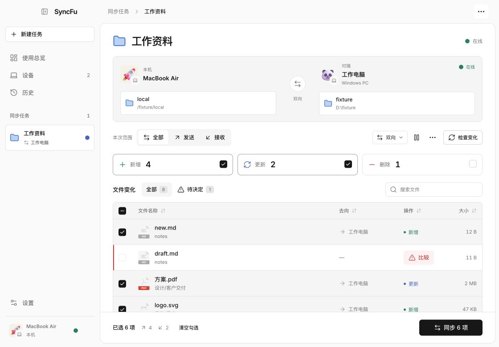
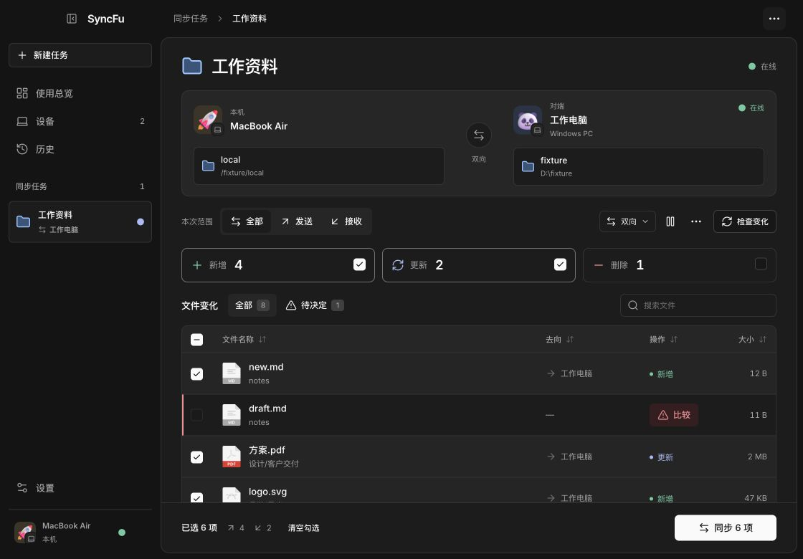

<p align="center"></p>
<h1 align="center">SyncFu 0.1.0</h1>
<p align="center">两台电脑，同一份资料。面向 Windows 与 macOS 的局域网文件夹同步工具。</p>
<p align="center">简体中文 · <a href="docs/README.en.md">English</a> · <a href="docs/README.md">文档</a> · <a href="CONTRIBUTING.md">参与贡献</a> · <a href="SECURITY.md">安全说明</a></p>
<p align="center"><a href="https://github.com/zzephyrxx/SyncFu/actions/workflows/ci.yml"></a> <a href="LICENSE"></a></p>

> **0.1.0 为开发阶段版本。** 当前提供手动同步，尚未完成 Windows 原生交互及实体双机 LAN 验收。请先使用专用测试目录，并保留独立备份。

## 功能

- **按任务同步**：双向、单向更新、严格镜像；每次可选择发送、接收或全部变化。
- **清楚处理变化**：新增、更新、删除跨页批选；冲突比较、选择版本、稍后处理或排除路径。
- **保留操作保护**：写前预检，覆盖／删除前备份，危险操作确认，受保护撤销与中断结果核对。
- **局域网连接**：优先选择扫描到的设备，输入五位配对码；手动 IP 为备用入口，无需云账户或中继。
- **桌面体验**：可折叠侧栏、独立总览、浅深主题、设备备注与 Fluent Emoji 头像，支持五种界面语言。

| 任务工作区 | 深色主题 |
| --- | --- |
|  |  |

截图使用测试设备与目录。界面采用 shadcn/ui、Radix、Lucide、Fluent Emoji、Phosphor 和 react-file-icon；实现与来源见 [UI 文档](docs/ui/README.md)。

## 版本与平台

本项目只维护 **SyncFu 0.1.0**，应用标识为 `org.syncfu.desktop`。构建入口、包名和输出目录统一，不再另发带设计阶段名称的应用。

| 项目 | 支持范围 |
| --- | --- |
| Windows | Windows 10 22H2／Windows 11 x64，使用 WebView2 |
| macOS | macOS 13+，Apple Silicon 或 Intel 原生构建 |
| 网络 | 可互通的 IPv4 局域网，默认 TCP `47657` |
| 协议 | 对等协议 **4**、状态 schema **3**；不可与 protocol 3 客户端混用 |
| 同步方式 | 手动执行；自动检查只读，自动写入调度尚未实现 |

## Windows 源码包与构建

使用 `SyncFu-0.1.0-windows-source.zip`，完整解压后进入 `SyncFu-0.1.0` 文件夹。

1. 安装 **Node.js 22.18+**、**Rust stable（MSVC）**、**Microsoft C++ Build Tools** 的“使用 C++ 的桌面开发”组件，以及 **WebView2 Runtime**。
2. 双击根目录 **Build-Windows.cmd**，或在终端执行：

```powershell
node scripts/build.mjs windows
```

脚本校验版本与源码包指纹，安装锁定依赖、运行检查，再生成安装包。首次构建需要联网；源码包不包含依赖缓存。

成功输出：`releases/0.1.0/SyncFu-0.1.0-windows-x64-setup.exe`。

[完整构建说明](docs/building.md) 包含环境检查、离线 WebView2 选项、macOS 构建和源码包校验。

## 本地开发

安装 [Tauri 平台依赖](https://v2.tauri.app/start/prerequisites/)，在源码根目录执行：

```bash
npm ci
npm run tauri dev
```

仅预览界面：运行 `npm run dev`，打开 `http://localhost:1420/?desktop-test`。此开发夹具不连接真实设备，也不修改同步目录。

## 第一次同步

1. 两台电脑连接同一局域网，在「设备 → 连接设备」中，一端等待，另一端选择扫描到的设备并输入其配对码；由等待端确认。
2. 两端分别授权一个专用测试文件夹，创建任务并确认目录、设备关系和同步方向。
3. 检查变化清单，选择需要同步的项目。未解决冲突不能直接执行，删除默认不选。
4. 点击「同步」，核对危险操作提示和最终结果。部分完成时，到历史中核对，不要假定两端已一致。

完整测试步骤见 [双机测试指南](docs/testing/README.md)。关闭窗口可能仍在托盘／菜单栏运行，切换构建前请退出旧进程。

## 项目结构

```text
core/                 Rust 同步、策略、备份与恢复内核
src/                  React 桌面界面、共享模型与开发夹具
src/components/ui/    本地维护的 shadcn/Radix 组件
src-tauri/            Tauri 桌面入口和平台配置
assets/               品牌、图标素材、第三方许可与来源
scripts/              构建、打包、测试及测试资料工具
docs/                 构建、测试、UI 和架构文档
docs/archive/         历史设计记录，不随源码包分发
releases/0.1.0/       统一构建输出，不纳入源码版本控制
```

## 验证与限制

构建通过、浏览器交互通过和实体双机同步通过是不同结果。已有 UI 检查范围见 [UI 文档](docs/ui/README.md)，当前代码检查以对应提交的 CI 为准。源码包附带 SHA-256 清单，校验完整性不等于发布者签名。

同步不能代替独立备份。活动数据库、应用资料库、NAS、移动盘及完整系统元数据保真不在当前验证范围；应用尚未经过独立安全审计。详细边界见 [SECURITY.md](SECURITY.md)。本地构建不承诺 Windows 代码签名或 Apple 公证。

开发与测试约定见 [CONTRIBUTING.md](CONTRIBUTING.md)，版本变化见 [CHANGELOG.md](CHANGELOG.md)。

## 许可

项目自有代码采用 [Apache-2.0](LICENSE)。第三方组件、字体与素材保留各自许可，构建时收集并随应用分发，详见 [NOTICE](NOTICE) 和 [UI 来源记录](docs/ui/sources.json)。SyncFu 是独立项目，不隶属于 Syncthing 或所用组件项目。
