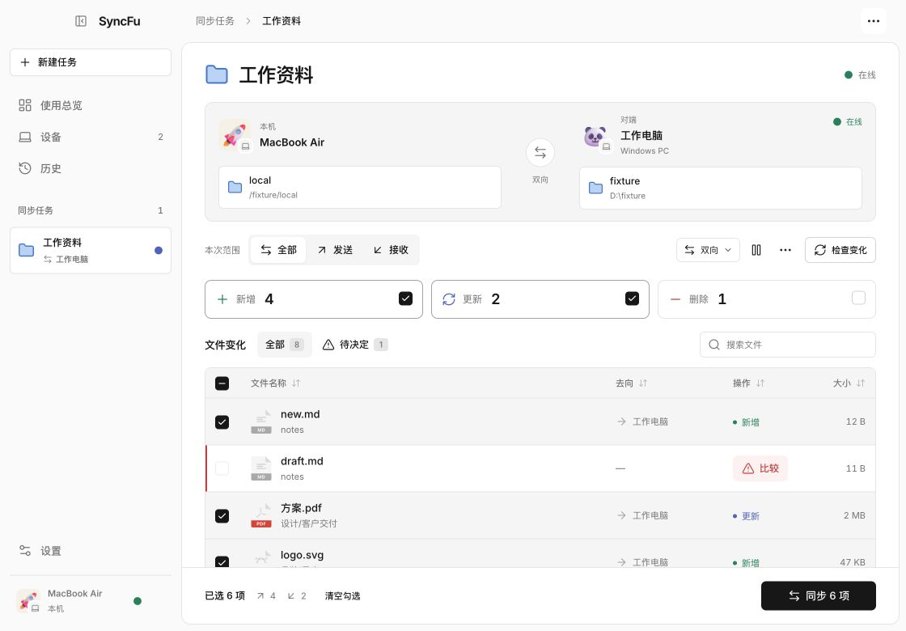
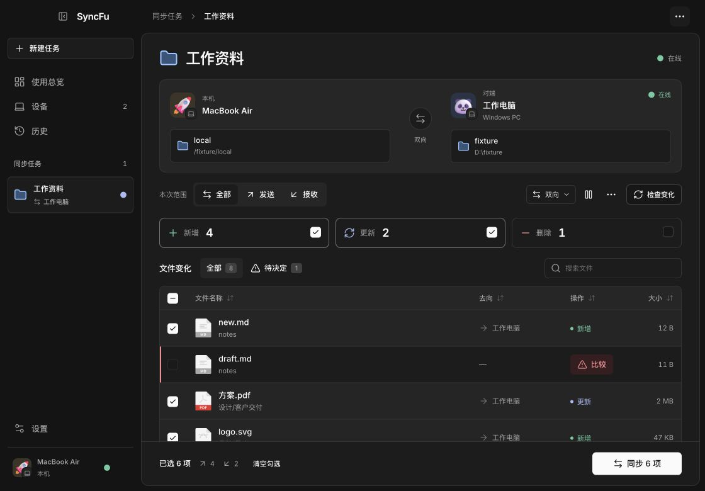

<p align="center"></p>
<h1 align="center">SyncFu</h1>
<p align="center">Two computers. One set of files. LAN folder synchronization for Windows and macOS.</p>
<p align="center"><a href="../README.md">简体中文</a> · English · <a href="README.md">Documentation</a> · <a href="../CONTRIBUTING.md">Contributing</a> · <a href="../SECURITY.md">Security</a></p>

> **Development preview, not a production-validated stable release.** Start with dedicated test folders and keep independent backups. Browser fixtures, automated tests and local builds do not establish physical two-device acceptance.

## Features

- **Per-task rules:** two-way synchronization, one-way updates, or strict one-way mirroring. Pairing initiator/receiver roles do not determine synchronization direction.
- **One operation list:** select additions, updates and deletions in bulk across all matching pages. Restrict a run to sending or receiving without changing the task's persistent rules.
- **Explicit conflict decisions:** compare versions, choose a source, defer, ignore the current versions, or exclude a path through the shared policy.
- **Fewer prompts, not fewer safeguards:** ordinary additions/updates execute after backend preflight. Deletions, selected conflict overrides, undo, risk approvals and expanded selections require review.
- **Recoverable operations:** backup before overwrite/deletion, per-operation receipts, protected undo and reconciliation after interruption.
- **Local-first:** no cloud account or relay required; files move directly between LAN peers.
- **LAN-first pairing:** choose a discovered device and enter its five-digit pairing code in separate digit boxes. Manual IP entry is available as a fallback.
- **Recognizable devices and tasks:** save device aliases, Fluent Emoji avatars and optional device-type icons locally; custom emoji have a system-font fallback and original device names remain available. Colored folder icons identify tasks in a collapsible sidebar whose state persists.
- **Clear synchronization endpoints:** device names, folders and transfer direction have separate places in the task workspace and compact task-creation form.
- **Desktop navigation:** a dedicated usage overview, theme selection in Settings, and a single-row macOS toolbar with space for native window controls.
- **Consistent controls:** light/dark themes, filename-first rows, accessible selection controls, and Simplified Chinese, Traditional Chinese, English, Japanese and Korean.

| Task workspace | Dark theme |
| --- | --- |
|  |  |

Screenshots use isolated test devices and folders, not a physical two-device synchronization session. See the [current desktop UI record](shadcn-redesign/README.md) for the implementation scope and validation limits.

### Current UI implementation

The existing Tauri/Rust application adopts tauri-ui desktop conventions for window layout, text selection and scrolling. The scaffolder is not rerun over this project. Vendored shadcn/ui components and Radix primitives supply buttons, fields, selection controls, dialogs and menus.

| Element | Implementation |
| --- | --- |
| Device avatars | Local Microsoft Fluent Emoji 3D images, with a system-font fallback for custom emoji |
| Device types, actions and task folders | Lucide, including colored flat folders for individual tasks |
| Connectivity and task status | Phosphor Circle weights and colors, accompanied by status text |
| File types and conflicts | react-file-icon file glyphs and red Lucide conflict warnings |

BoardUI, Morphicons and EasyUI designs and provenance remain historical records; they no longer describe the components used by the current interface.

## Status and requirements

| Area | Status |
| --- | --- |
| Windows | Target: Windows 10 22H2 / Windows 11 x64 with WebView2 |
| macOS | Target: macOS 13+, Apple Silicon and Intel build targets |
| Linux / mobile | Not supported |
| Automatic synchronization | Automatic **read-only checks** exist; automatic writes are not implemented |
| Network | Mutually reachable IPv4 LAN; TCP `47657` by default; no relay or NAT traversal |
| Compatibility | Peer protocol **4**, state schema **3**; incompatible with protocol 3 peers |
| Distribution | Source first; successful GitHub Actions runs provide build artifacts, not signed stable releases |

Windows installers use an existing WebView2 runtime or download it if missing. Building dependencies, installing WebView2 for the first time and manually opening the release page may require internet access.

## Run locally

Install [Node.js 22.18+](https://nodejs.org/), [Rust stable](https://www.rust-lang.org/tools/install), and the [Tauri platform prerequisites](https://v2.tauri.app/start/prerequisites/). Clone this repository, enter its directory, then run:

```bash
git clone https://github.com/zzephyrxx/SyncFu.git
cd SyncFu
npm ci
```

```bash
npm run tauri dev
```

For a browser-only UI fixture:

```bash
npm run dev
```

Open `http://localhost:1420/?desktop-test`. This development-only entry cannot connect to real peers or modify synchronization folders. The browser homepage is not the native desktop runtime.

## First synchronization

1. Put both computers on the same LAN and open **Devices → Connect**. Let one device wait for a connection. On the initiating device, select it from the discovered LAN devices and enter its **five-digit pairing code**; pasting the complete code is supported, including leading zeros. Confirm the request on the waiting device. If discovery does not find the device, expand the manual IP fallback.
2. Authorize a dedicated test folder on each device. Do not authorize an entire home, Desktop or system directory.
3. Link the two grants in a task. Confirm the personal/shared relationship and direction; initial classification requires peer approval.
4. Inspect changes. Non-conflicting additions/updates are initially selected; deletions and unresolved conflicts are not. Selection cards never execute changes themselves.
5. Click **Sync**. Review any dangerous or expanded operation list. After a partial result or disconnection, reconcile history instead of assuming both folders match.

The one-run scope does not change persistent rules. Closing the window may leave SyncFu running in the tray/menu bar; use the quit action before starting another version.

See the [acceptance guide](acceptance/README.md) for dedicated test data and staged checks.

## Build

Build on the target operating system. These commands use the normal application identity.

### macOS application

For an Apple Silicon application, run on an Apple Silicon Mac:

```bash
npm run tauri -- build --bundles app
```

Output: `target/release/bundle/macos/`.

To build a universal application for both Apple Silicon and Intel:

```bash
rustup target add aarch64-apple-darwin x86_64-apple-darwin
```

```bash
npm run tauri -- build --target universal-apple-darwin --bundles app
```

Output: `target/universal-apple-darwin/release/bundle/macos/`.

### Windows installer

```bash
npm run tauri -- build --target x86_64-pc-windows-msvc --bundles nsis
```

Output: `target/x86_64-pc-windows-msvc/release/bundle/nsis/`. To explicitly bundle the much larger offline WebView2 runtime:

```bash
npm run tauri -- build --target x86_64-pc-windows-msvc --bundles nsis --config src-tauri/tauri.offline.json
```

The isolated acceptance app uses `org.syncfu.acceptance.p2`, not the normal `org.syncfu.desktop` identity. Older acceptance tasks may persist. See the [acceptance instructions](acceptance/README.md); do not run old and new acceptance processes simultaneously.

## Verification and limits

This tauri-ui/shadcn iteration passed all **83 tests** in `npm test` and successfully built the **macOS arm64 application**. Browser checks covered 1120 × 780 and 680 × 560 windows in light and dark themes. See the [desktop UI notes](shadcn-redesign/README.md) for the behavior checks and screenshots.

- The screenshots and browser checks use the `desktop-test` fixture, covering device-profile and sidebar persistence, pairing-code input, file selection, menus and dialogs without connecting to real peers.
- The successful macOS application build does not establish acceptance of operating-system permissions or native interactions. The [previous UI refresh record](ui-refresh/README.md) retains its own macOS preview results.
- **Native Windows window behavior and physical two-device LAN synchronization have not been validated in this iteration.**
- A local build or ad-hoc signature verification is not Developer ID signing, Apple notarization or production acceptance.

SyncFu uses PAKE pairing, mutual TLS, SHA-256 verification, authorized roots, write-time checks and deletion risk gates. It has not received an independent security audit. Undo protects later edits and reverses the recorded batch's changes; it is not a whole-folder snapshot restore. Synchronization is not a substitute for independent backups.

Current validation targets ordinary files/folders on internal disks at roughly 10,000 files per task. Active databases, application libraries, NAS, removable media and complete system-metadata preservation are outside the current acceptance scope. Read [SECURITY.md](../SECURITY.md) before testing with important data.

## Troubleshooting

- Discovery failures: check IPv4 reachability, Wi-Fi client isolation and firewall rules, or enter the peer address manually.
- Use **Settings → Permission checks** to diagnose local-network access. Limit inbound access to trusted private networks.
- Proxy/mirror failures during builds are build-machine configuration issues. Do not disable TLS verification or substitute an old installer.
- Reconcile partial results while both peers are online; preserve `.syncfu-stage` until recovery is understood.
- For unsigned-app warnings, verify the source and retain the exact error. Do not disable Gatekeeper or SmartScreen.

## Development and licensing

See [CONTRIBUTING.md](../CONTRIBUTING.md) for checks and contribution boundaries, and [the documentation index](README.md) for architecture and historical records.

First-party code is licensed under [Apache-2.0](../LICENSE); see [NOTICE](../NOTICE). The current interface adopts tauri-ui desktop conventions and uses vendored shadcn/ui/Radix controls, Microsoft Fluent Emoji, Lucide, Phosphor, react-file-icon and Inter. See the [current implementation record](shadcn-redesign/README.md), [shadcn license](../assets/shadcn-licenses/shadcn-MIT.txt), and [Fluent avatar provenance and checksums](../assets/fluent-emoji/sources.json).

The licenses and provenance for earlier BoardUI, Morphicons and EasyUI implementations remain with the historical source. React Bits was evaluated but no component source was copied. Dependency notices accompany application distributions, and third-party components retain their original licenses.

SyncFu is independent and is not affiliated with Syncthing or the referenced UI/asset projects.
