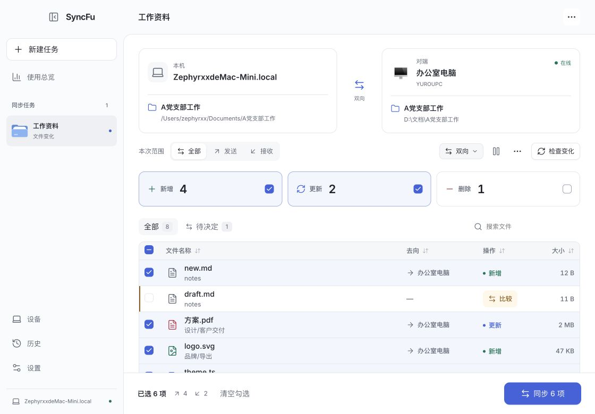
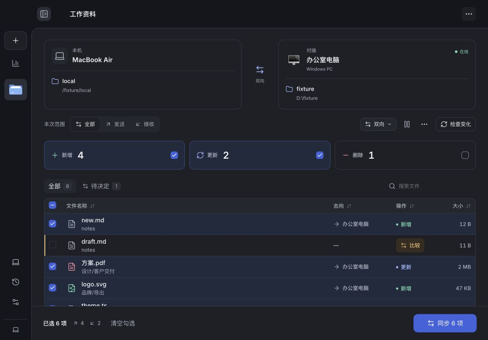
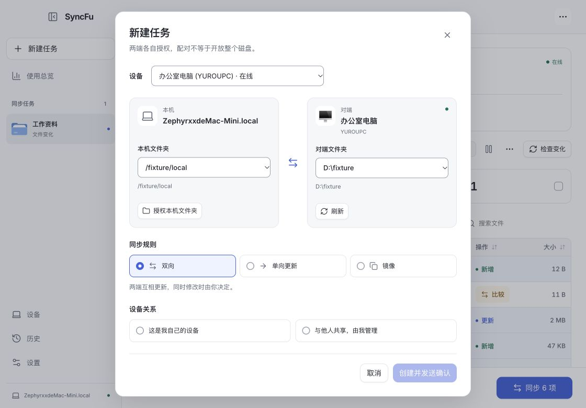
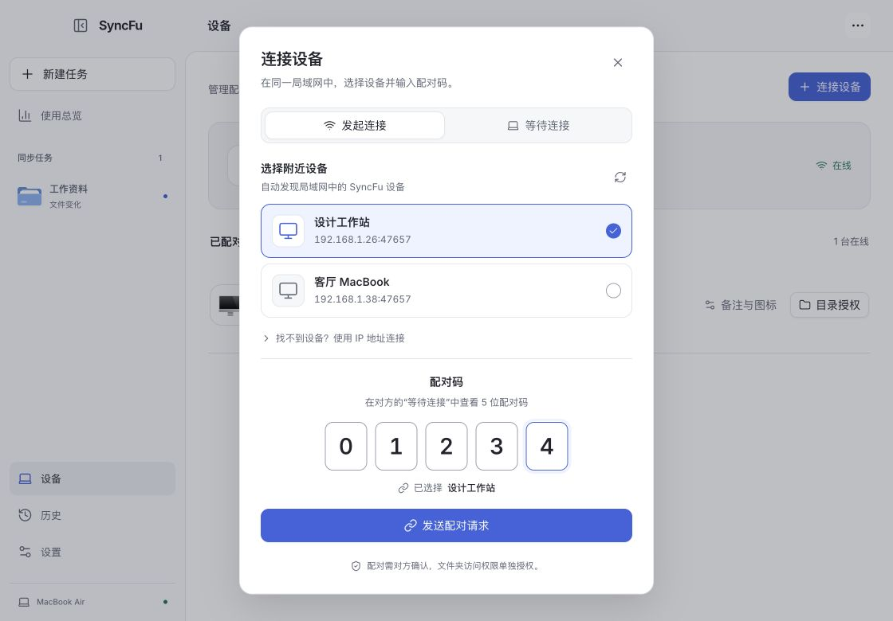
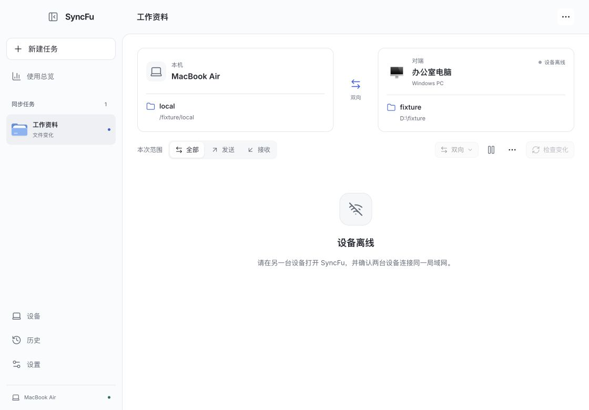

# SyncFu 桌面界面重构 · 2026-11-15

这轮实现位于正式 `src/desktop` 入口，沿用真实同步控制器和单清单操作方式。

## 界面变化

- 单层 macOS 工具栏：原生窗口控件预留空间与侧栏开关、页面标题共用一行。
- 侧栏支持展开/收起并持久化；EasyUI 文件夹实际用于任务入口，颜色根据任务 ID 稳定映射。
- 使用总览成为独立主导航页面；主题只在设置中选择。
- 设置中的素材页展示正在使用的 BoardUI 控件、EasyUI 文件夹、Morphicons / Lucide 图标与字体，并提供对应许可证。
- 连接默认选择扫描到的局域网设备，IP 是折叠备用入口；统一使用“配对码”，五格数字输入支持前导零、粘贴、自动跳格和键盘修正。
- 配对审批握手期间显示明确等待状态，最多 18 秒后解锁；已被消费的配对码不会在请求断开后重新显示为有效。
- 新建任务采用紧凑表单；任务页与表单用独立卡片区分本机/对端、设备名、文件夹与方向。
- 已配对设备支持本机保存备注名和 emoji，任务端点、方向菜单与文件去向同步使用备注，原始设备名仍可查看。
- 复选框、单选卡、焦点与禁用状态统一；离线使用 WifiOff 图标与可执行的连接提示。

## 验证与交付

- `npm test`：81 项通过，包含类型检查、生产构建、同步选择/保护契约与新增设备资料持久化测试。
- 浏览器 DEV transport：1120 × 780 与最小桌面尺寸 680 × 560；检查浅/深主题、折叠与重载保持、长设备名、离线、总览、素材、任务方向、新建任务、备注保存与联动。
- 连接交互：LAN 选择、整码粘贴、前导零、退格、末格覆盖、备用 IP、生成/复制反馈及模拟请求完成均经过浏览器操作。
- 独立应用标识的 macOS WKWebView 预览启动成功，确认单行工具栏与侧栏折叠；原生截图左上角的紫色区域为系统窗口共享指示器。
- 当前应用构建为 Apple Silicon / arm64；打包后补做 ad-hoc 签名并通过 `codesign --verify --deep --strict`，ZIP 完整性通过。未做 Developer ID 公证。Windows 原生窗口和实体双机 LAN 同步未在这轮验证。
- Vite 保留桌面 JS 大于 500 KB 的构建提示，构建正常完成。

## 界面截图

截图使用隔离的测试设备和目录，不是实体双机运行记录。

| 任务工作区 | 折叠侧栏与深色主题 |
| --- | --- |
|  |  |

| 新建任务 | 局域网配对 |
| --- | --- |
|  |  |

完整本地截图和日志在被 Git 忽略的 `artifacts/ui-refresh`。仓库保留以上五张界面截图；CI 构建产物可在仓库的 Actions 页面下载。

应用：`target/release/bundle/macos/SyncFu.app`。压缩交付：`artifacts/ui-refresh/SyncFu-macOS-arm64.zip`。
