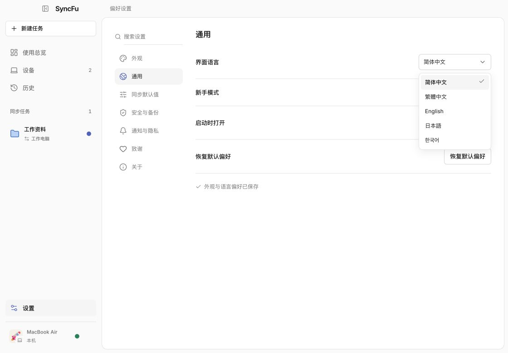
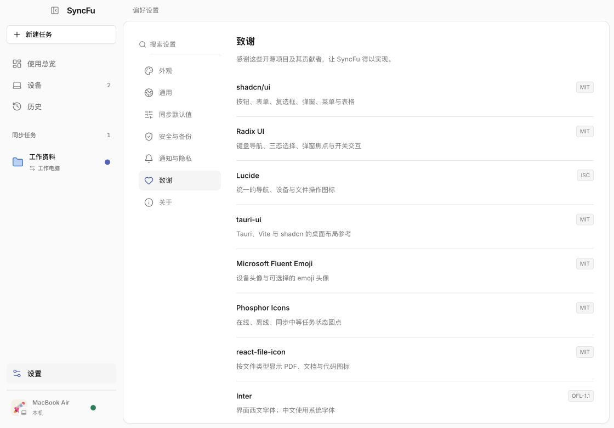
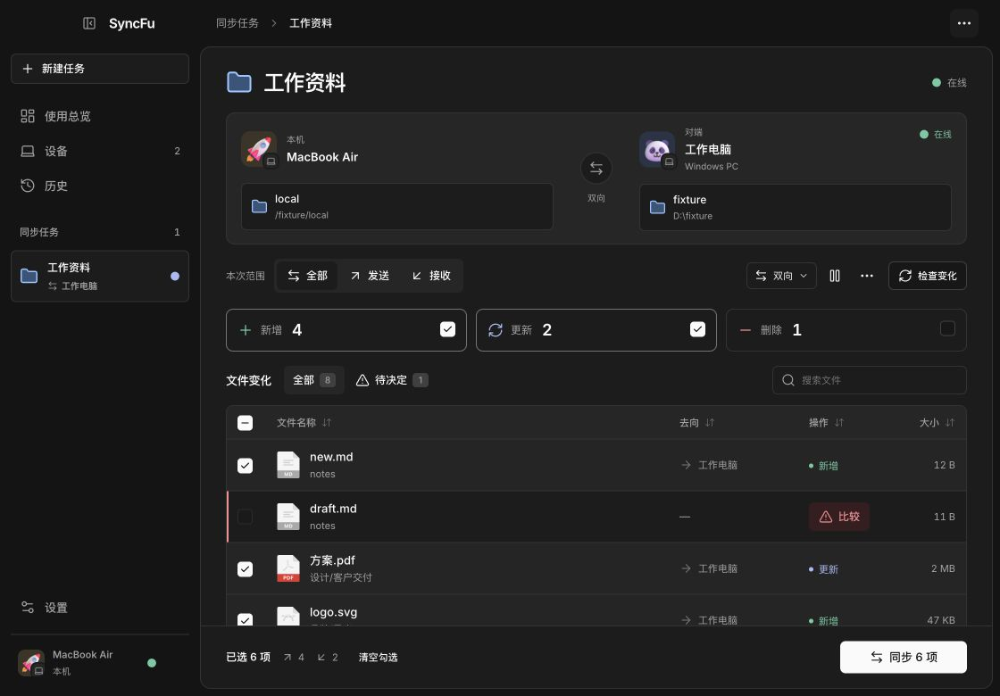
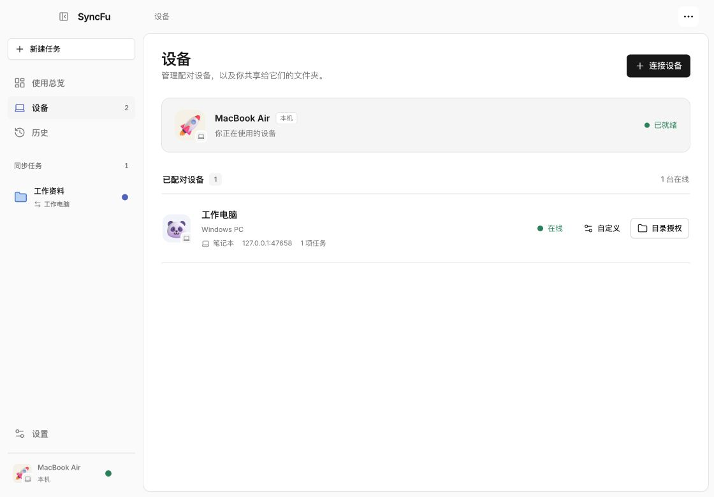
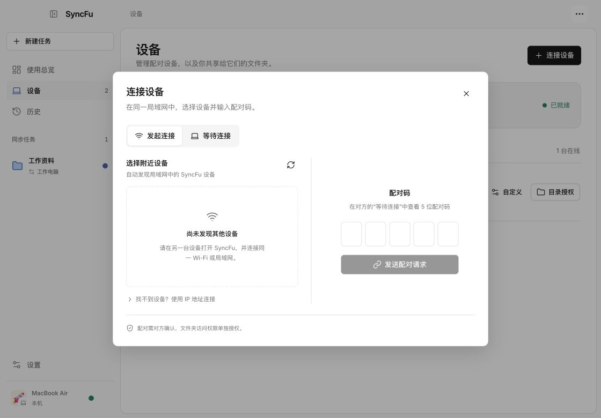

# SyncFu 0.1.0 desktop UI

The production controls are now vendored shadcn/ui components, using Radix primitives and lucide-react. The old `src/desktop/ui/UI.tsx` path remains as a compatibility facade for application views; it no longer imports the BoardUI vendor components, React Aria, or Morphicons.

`agmmnn/tauri-ui` is a scaffolder around the official shadcn and create-tauri-app CLIs, not a separate widget library. Its Vite and native-shell composition was reviewed as the desktop reference. SyncFu retains its working Tauri backend, device discovery, pairing protocol and policy engine instead of replacing the application with a sample scaffold.

## Actual implementation

- `src/components/ui/`: Button, Checkbox, Dialog, DropdownMenu, Select, Popover, Switch, Tooltip, Table, Input and Textarea adapted from the official shadcn Radix registry.
- `selection.tsx`: application selection adapters, including controlled indeterminate state and whole-label selection cards.
- `tokens.css`: neutral light/dark semantic tokens. Hex colours preserve compatibility with the existing desktop browser targets; the radius scale is tightened to 6–8px.
- `primitives.css`: compatibility sizing and state styles. Dialogs retain Radix focus trapping, Escape handling, opener restoration and the pairing finalization dismissal guard. Menus retain roving keyboard focus; path details use a Popover.
- `src/desktop/ui/icons.tsx`: official lucide-react components. The user-provided app logo is unchanged.

The original registry files are retained under `upstream/`. `sources.json` records exact content hashes, source URLs and local adaptations. shadcn and Radix licenses are distributed in `assets/licenses/`; Lucide and Inter licenses remain in assets/licenses/. The upstream tauri-ui package declares MIT, documented in its retained package snapshot and the local notice.

## Source references

- https://github.com/agmmnn/tauri-ui
- https://github.com/shadcn-ui/ui/tree/main/apps/v4/registry/new-york-v4/ui
- https://ui.shadcn.com/docs/theming

No authentication, sample dashboard data, debug panel, analytics or updater from the scaffolder was added to SyncFu.

## Settings and selection controls

Settings retain the existing neutral light/dark tokens and Inter/system typography. Selection controls use a compact bordered trigger with a contained Lucide chevron; the popover uses the same surface, border and selected-state treatment as other desktop menus. Long values truncate within the trigger, while the option list remains scrollable and keyboard accessible.

The acknowledgements page lists project credits and license links without interactive component demonstrations. The About page centers the original application icon, name, version and slogan, followed by developer and project information. The former computer-handoff action is removed from the window toolbar; actual device connections and task synchronization remain in their own pages.

## Verification — 2026-11-15

The current revision passed all **84 tests** in `npm test` and successfully built the **macOS arm64 application**. Browser checks used the `desktop-test` fixture at **1120 × 780** and **680 × 560**, including light and dark themes.

| Area | Observed result |
| --- | --- |
| Select controls | The chevron stays inside the 35px trigger with an 11px right inset. Mouse selection, arrow-key selection and Escape focus restoration passed in settings; light/dark and 680 × 560 menus remain inside the viewport. |
| New-task selections | Empty folder choices disable submission; valid folder choices restore it after a device relationship is selected. Escape closes the menu without closing the dialog. |
| About and acknowledgements | The icon is centered; version 0.1.0, developer and slogan are visible. Acknowledgements contain project/license links with no demonstration buttons or input controls. |
| Toolbar | The obsolete computer-handoff action and its dialog/model/translations are removed. |
| Device profiles | Custom names and avatars persist after reloading. |
| Sidebar | Collapsed state persists after reloading. |
| Pairing | The segmented pairing-code input preserves a leading zero, advances between cells and handles Backspace. Manual IP entry remains available as a fallback to discovered devices. |
| File selection | The select-all control supports unchecked, mixed and checked states. It selects the seven executable changes; the eighth, conflicting change stays disabled. |
| Menu checkboxes | Selection works with both mouse and keyboard. |
| Dialogs | Escape dismisses dismissible dialogs, and long content remains scrollable at the minimum checked window size. |

These checks and screenshots use fixture devices and files. They are **not physical two-device LAN acceptance**. Native Windows behavior and real LAN synchronization have not been validated in this iteration. The successful macOS build does not establish Developer ID signing, Apple notarization, operating-system permission acceptance or production readiness.

## Screenshots

All screenshots below show the `desktop-test` fixture rather than a live peer connection. The settings screenshots reflect the latest refinement; the workspace, devices and pairing images document the preceding UI pass.

| Settings dropdown | About |
| --- | --- |
|  |  |

| Workspace · light | Workspace · dark |
| --- | --- |
|  |  |

| Devices | Pairing |
| --- | --- |
|  |  |

| New task | Minimum window · 680 × 560 |
| --- | --- |
|  |  |
