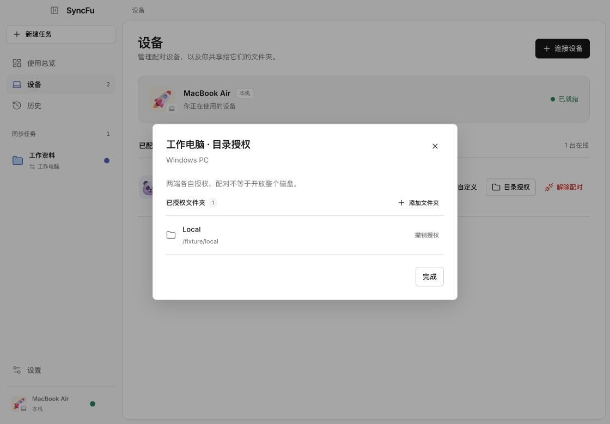
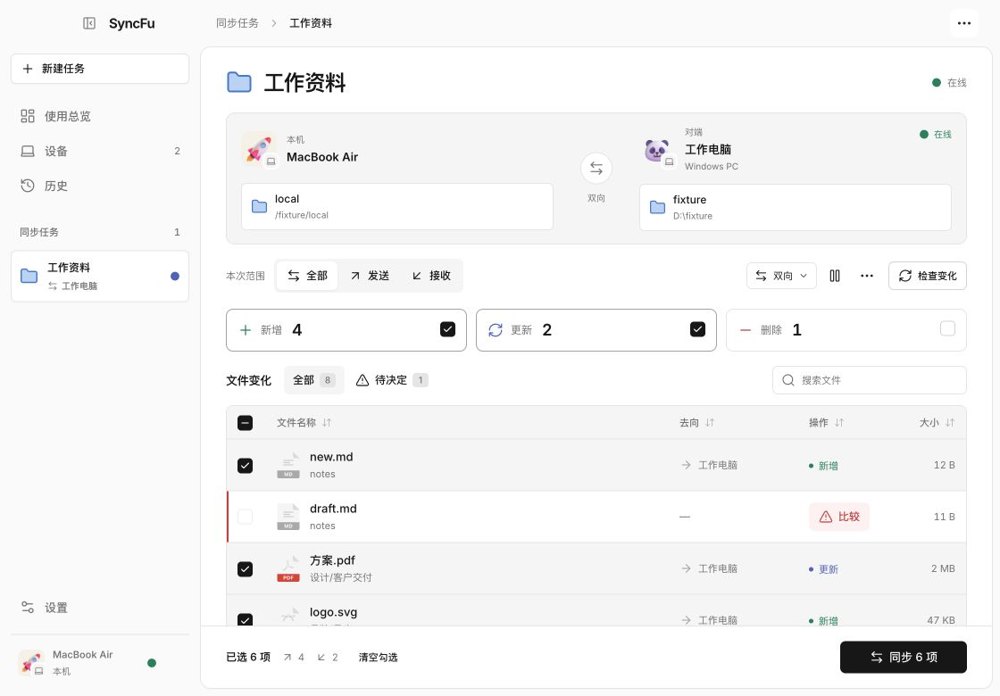
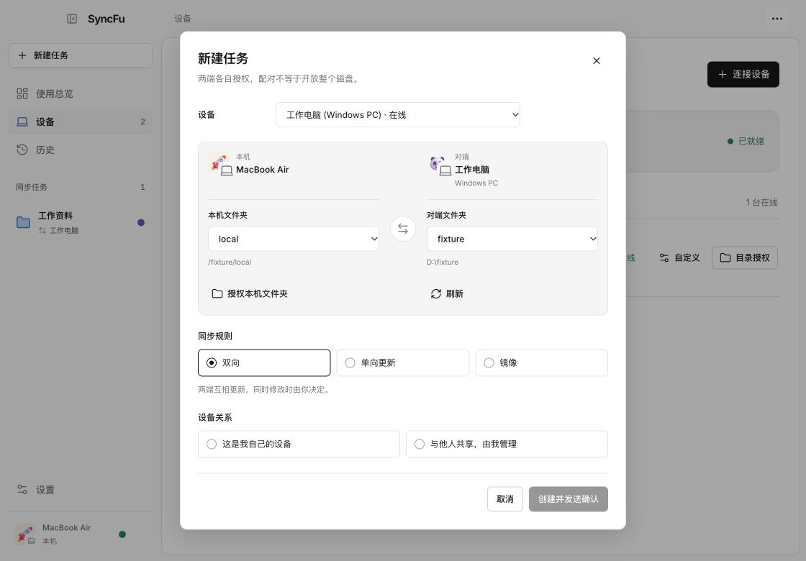
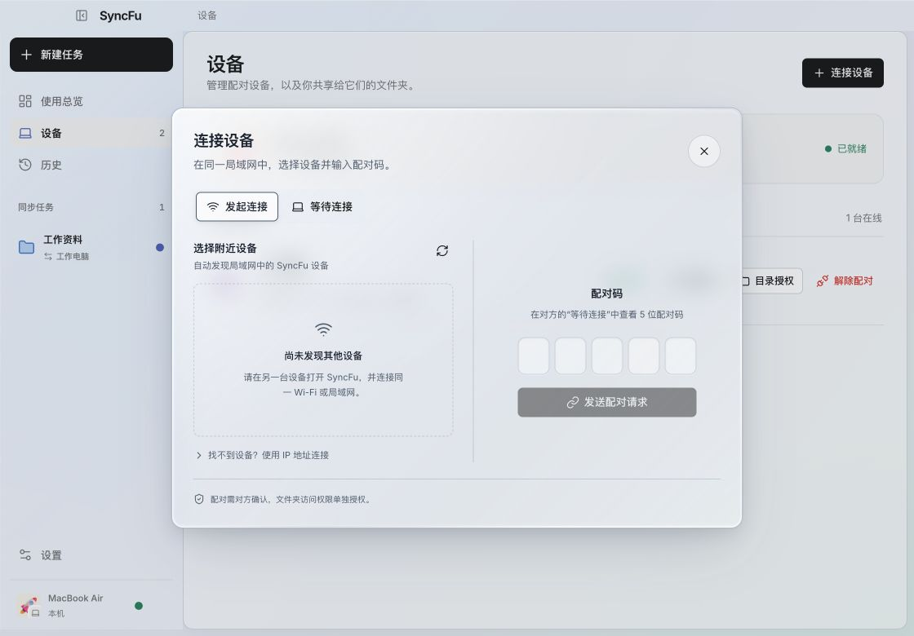
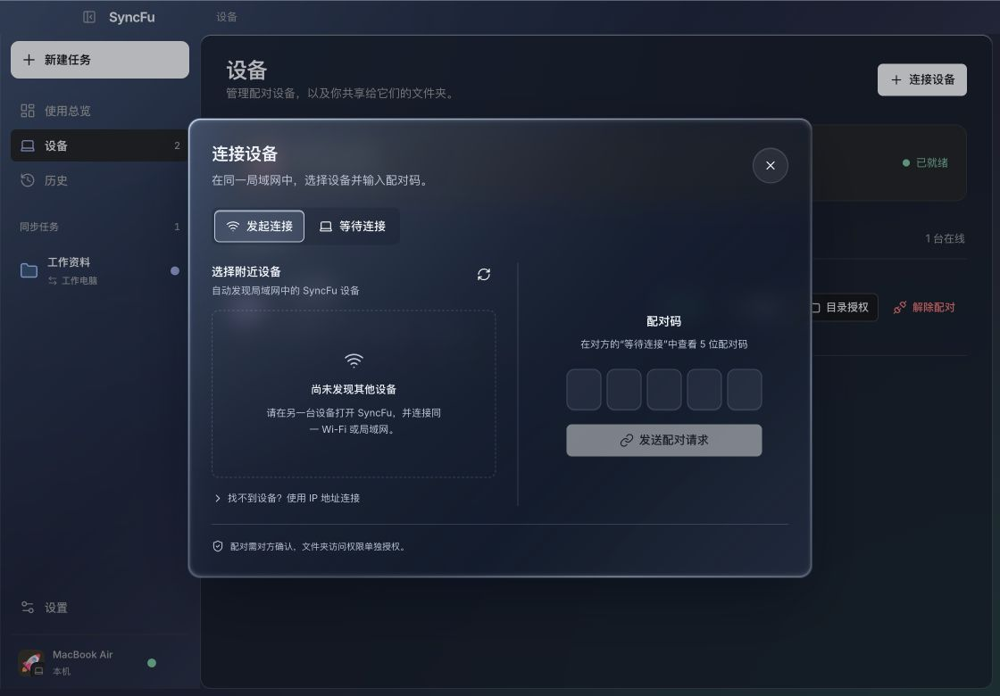

# SyncFu 0.1.0 desktop UI

The production controls are now vendored shadcn/ui components, using Radix primitives and lucide-react. The old `src/desktop/ui/UI.tsx` path remains as a compatibility facade for application views; it no longer imports the BoardUI vendor components, React Aria, or Morphicons.

`agmmnn/tauri-ui` is a scaffolder around the official shadcn and create-tauri-app CLIs, not a separate widget library. Its Vite and native-shell composition was reviewed as the desktop reference. SyncFu retains its working Tauri backend, device discovery, pairing protocol and policy engine instead of replacing the application with a sample scaffold.

## Actual implementation

- `src/components/ui/`: Button, Checkbox, Dialog, DropdownMenu, Select, Popover, Switch, Tooltip, Table, Input and Textarea adapted from the official shadcn Radix registry.
- `selection.tsx`: application selection adapters, including controlled indeterminate state and whole-label selection cards.
- `tokens.css`: neutral light/dark semantic tokens. Hex colours preserve compatibility with the existing desktop browser targets; the radius scale is tightened to 6–8px.
- `primitives.css`: compatibility sizing and state styles. Dialogs retain Radix focus trapping, Escape handling, opener restoration and the pairing finalization dismissal guard. Menus retain roving keyboard focus; path details use a Popover.
- `src/desktop/ui/icons.tsx`: official lucide-react components. The user-provided app logo is unchanged.
- `src/desktop/views/Overview.tsx` and `overview.css`: daily byte chart and processed-file heatmap, both based on the same completed real records and 7/30-day range. Tooltips use the shared Radix portal, collision handling and keyboard focus rather than absolutely positioned children of the clipped chart container.
- `src/desktop/ScanStatus.tsx`: per-device discovery/verification, actual file/byte counts and the bounded current work queue. A finished batch does not imply finished directory discovery.
- `src/desktop/ExecutionStatus.tsx`: current file, transfer bytes and confirmed applied-item totals. File progress is fetched separately in pages; waiting, transferred and applied states stay distinct.

The original registry files are retained under `upstream/`. `sources.json` records exact content hashes, source URLs and local adaptations. shadcn and Radix licenses are distributed in `assets/licenses/`; Lucide and Inter licenses remain in assets/licenses/. The upstream tauri-ui package declares MIT, documented in its retained package snapshot and the local notice.

## Source references

- https://github.com/agmmnn/tauri-ui
- https://github.com/shadcn-ui/ui/tree/main/apps/v4/registry/new-york-v4/ui
- https://ui.shadcn.com/docs/theming

No authentication, sample dashboard data, debug panel, analytics or updater from the scaffolder was added to SyncFu.

## Settings and selection controls

Settings retain the existing neutral light/dark tokens and Inter/system typography. Selection controls use a compact bordered trigger with a contained Lucide chevron; the popover uses the same surface, border and selected-state treatment as other desktop menus. Long values truncate within the trigger, while the option list remains scrollable and keyboard accessible.

The acknowledgements page lists project credits and license links without interactive component demonstrations. The About page centers the original application icon, name, version and slogan, followed by developer and project information. The former computer-handoff action is removed from the window toolbar; actual device connections and task synchronization remain in their own pages.

## Optional surface material

Settings → Appearance offers **Solid / Liquid glass**, persisted as a local preference. Solid remains the default. `src/desktop/glass.css` implements the same CSS material on macOS WKWebView and Windows WebView2:

- Translucent floating surfaces sample the live page with a 14px backdrop blur and modest saturation. A lighter, unblurred overlay preserves the background instead of turning it into a flat dark sheet.
- A 22px dialog shell has a directional specular rim, inner edge light and two-scale shadow. Mask-based rim enhancement is gated by support; text and controls are never filtered.
- Route cards, pairing-code inputs, device-avatar controls, selectors and menus share translucent control tokens. Primary and destructive actions retain their semantic colors.
- The shell and close button remain stationary while long dialog bodies scroll. Long titles/paths have a bounded, independently scrollable header area.
- Light and dark palettes both return to solid surfaces for reduced transparency, increased contrast and forced colors. Unsupported backdrop filters keep the original solid UI.

The independent implementation references the layering in [SemiDone's dialogs](https://github.com/zzephyrxx/SemiDone/blob/d6d7ef3fcc94ac552e4bad1e417a65bc84f7aaef/src/styles/liquidGlassDialogs.css), [surface CSS](https://github.com/zzephyrxx/SemiDone/blob/d6d7ef3fcc94ac552e4bad1e417a65bc84f7aaef/src/styles/liquidGlassSurfaces.css) and [material settings](https://github.com/zzephyrxx/SemiDone/blob/d6d7ef3fcc94ac552e4bad1e417a65bc84f7aaef/src/utils/liquidGlassSettings.ts), pinned to commit `d6d7ef3fcc94ac552e4bad1e417a65bc84f7aaef`. This is CSS transmission and specular lighting, not native wallpaper sampling or geometric refraction. SVG backdrop filters are deliberately avoided because [WebKit does not reliably render them](https://bugs.webkit.org/show_bug.cgi?id=245510).

## Verification — 2026-11-15

The following table records the preceding UI verification pass using the `desktop-test` fixture at **1120 × 780** and **680 × 560**, including light and dark themes. Test counts and build results belong to their specific revision; the new large-task progress, heatmap and material changes require their own current check record.

| Area | Observed result |
| --- | --- |
| Scanning | Current paths, file/byte counters and indeterminate/determinate progress render in light/dark and minimum windows; completed checks restore the sync button. Partial results show an explicit blocking reason. |
| Rules | Compact columns and visible primary acceptance. Incoming proposals show accept/reject; outgoing confirmation refresh stays open and names the device still awaited. |
| Device actions | Row-level unpairing requires confirmation with the device and affected tasks; cancellation preserves the device. Existing grants use a compact Add folder action. |
| Select controls | The chevron stays inside the 35px trigger with an 11px right inset. Mouse selection, arrow-key selection and Escape focus restoration passed in settings; light/dark and 680 × 560 menus remain inside the viewport. |
| New-task selections | Empty folder choices disable submission; valid folder choices restore it after a device relationship is selected. Escape closes the menu without closing the dialog. |
| About and acknowledgements | The icon is centered; version 0.1.0, developer and slogan are visible. Acknowledgements contain project/license links with no demonstration buttons or input controls. |
| Toolbar | The obsolete computer-handoff action and its dialog/model/translations are removed. |
| Device profiles | Custom names and avatars persist after reloading. |
| Sidebar | Collapsed state persists after reloading. |
| Pairing | The segmented pairing-code input preserves a leading zero, advances between cells and handles Backspace. Manual IP entry remains available as a fallback to discovered devices. |
| File selection | The select-all control supports unchecked, mixed and checked states. It selects the seven executable changes; the eighth, conflicting change stays disabled. |
| Menu checkboxes | Selection works with both mouse and keyboard. |
| Dialogs | Escape dismisses dismissible dialogs, and long content remains scrollable at the minimum checked window size. |

These checks and screenshots use fixture devices and files. They are **not physical two-device LAN acceptance**. Native Windows behavior and real LAN synchronization have not been validated in this iteration. The successful macOS build does not establish Developer ID signing, Apple notarization, operating-system permission acceptance or production readiness.

## Screenshots

All screenshots below show the `desktop-test` fixture rather than a live peer connection. Scanning, rules and device-action screenshots reflect the latest fixes; the other images document preceding UI passes.

| Scan progress | Rule confirmation |
| --- | --- |
|  |  |

| Folder grants | Unpair confirmation |
| --- | --- |
|  |  |

| Settings dropdown | About |
| --- | --- |
|  |  |

| Workspace · light | Workspace · dark |
| --- | --- |
|  |  |

| Devices | Pairing |
| --- | --- |
|  |  |

| New task | Minimum window · 680 × 560 |
| --- | --- |
|  |  |

Current large-task UI proof (development fixtures, not user sync history):

- [Completed files and progress](screenshots/sync-completed-files.jpg)
- [File-count heatmap with complete tooltip](screenshots/overview-heatmap.jpg)
- [New task rules, relationship icons and primary action](screenshots/new-task-rules.jpg)
- [Optional glass appearance](screenshots/glass-appearance.jpg)

Both chart tooltips also fit within the 680 × 560 minimum window. A completed run retains its file list; a new inspection dismisses the old batch before accepting new results, so completed marks cannot be reused for a new plan.

### Liquid-glass dialog refinement — 2026-11-15

Checked the rendered UI with development fixtures at 1120 × 780 in both themes and 680 × 560 for scrolling/keyboard access. New-task, pairing, task-rule, device-profile and unpair confirmation dialogs show the same material; the device selector opens above the dialog without clipping. At the minimum window, the body scrolls to the primary action while the header stays fixed. Switching back to Solid restores the original white surface, 10px new-task corner radius and no backdrop filter or rim pseudo-elements. No pairing, deletion or synchronization was performed during this visual pass.

`npm test`: 90 passed, including production CSS scoping and fixture exclusion. Accessibility fallback selectors were reviewed for both light/dark specificity; OS-level contrast and reduced-transparency modes were not interactively emulated. Windows native visual inspection remains a separate device check.

| Pairing · light glass | Pairing · dark glass |
| --- | --- |
|  |  |

- [New task with translucent inner controls](screenshots/glass-dialog-light.jpg)
- [Task rules floating over the file list](screenshots/glass-rules-light.jpg)
