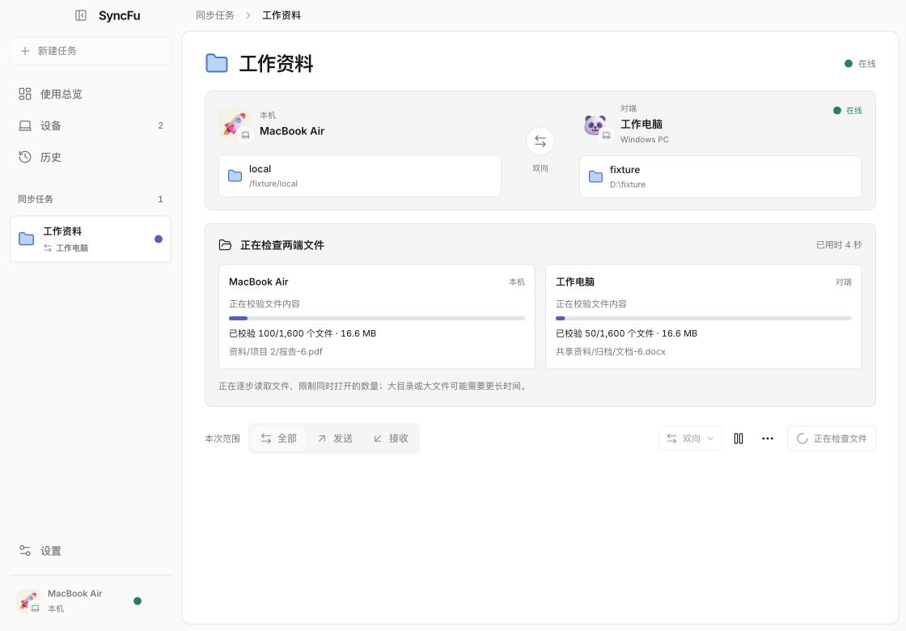
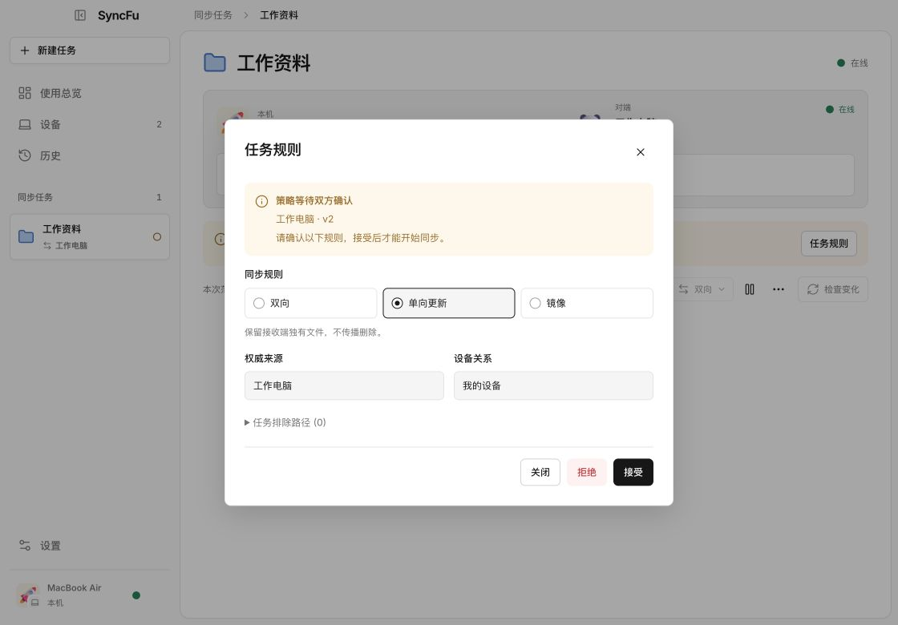
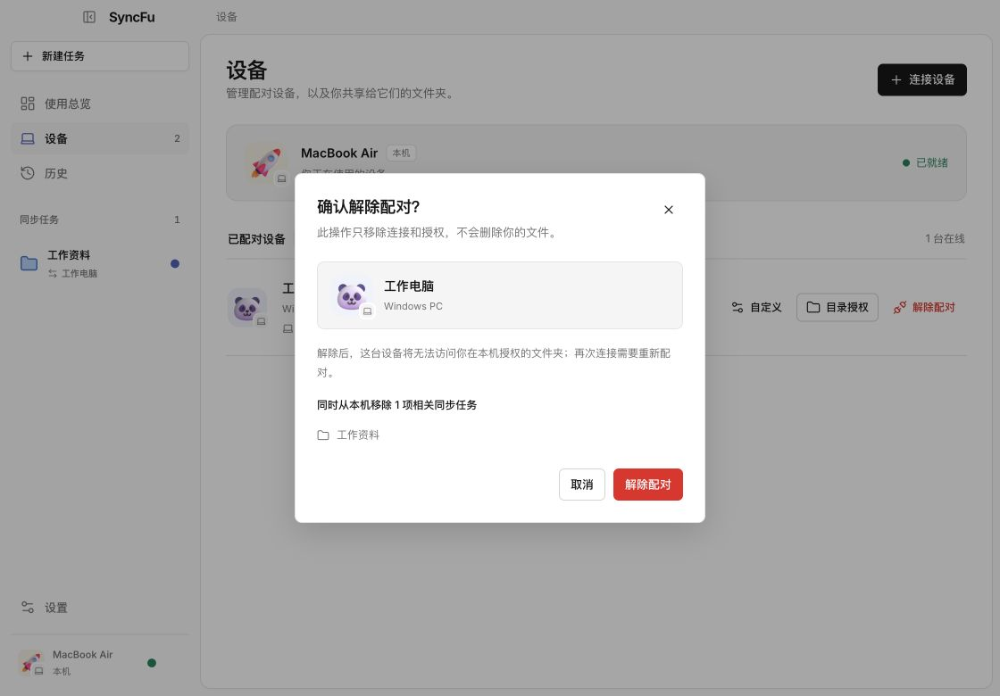
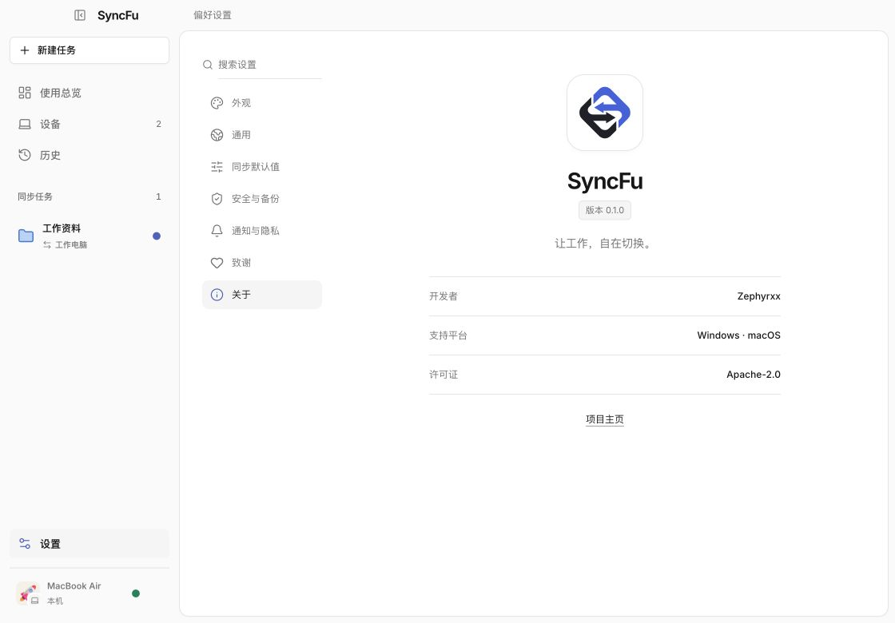
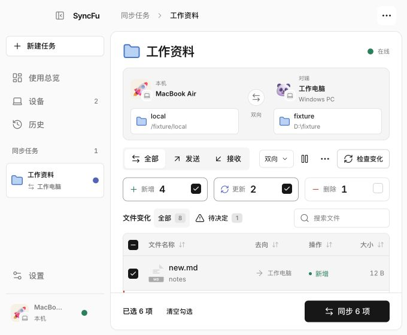

# SyncFu 0.1.0 desktop UI

The production controls are now vendored shadcn/ui components, using Radix primitives and lucide-react. The old `src/desktop/ui/UI.tsx` path remains as a compatibility facade for application views; it no longer imports the BoardUI vendor components, React Aria, or Morphicons.

`agmmnn/tauri-ui` is a scaffolder around the official shadcn and create-tauri-app CLIs, not a separate widget library. Its Vite and native-shell composition was reviewed as the desktop reference. SyncFu retains its working Tauri backend, device discovery, pairing protocol and policy engine instead of replacing the application with a sample scaffold.

## Actual implementation

- `src/components/ui/`: Button, Checkbox, Dialog, DropdownMenu, Select, Popover, Switch, Tooltip, Table, Input and Textarea adapted from the official shadcn Radix registry.
- `selection.tsx`: application selection adapters, including controlled indeterminate state and whole-label selection cards.
- `tokens.css`: neutral light/dark semantic tokens. Hex colours preserve compatibility with the existing desktop browser targets; the radius scale is tightened to 6–8px.
- `primitives.css`: compatibility sizing and state styles. Dialogs retain Radix focus trapping, Escape handling, opener restoration and the pairing finalization dismissal guard. Menus retain roving keyboard focus; path details use a Popover.
- `src/desktop/ui/icons.tsx`: official lucide-react components. The user-provided app logo is unchanged.
- `src/desktop/views/Overview.tsx` and `overview.css`: daily byte chart and processed-file heatmap, both based on the same completed real records and 7/30-day range. Tooltips use the shared Radix portal, collision handling and keyboard focus rather than absolutely positioned children of the clipped chart container.
- `src/desktop/ScanStatus.tsx`: per-device discovery/verification, actual file/byte counts and the bounded current work queue. A finished batch does not imply finished directory discovery.
- `src/desktop/ExecutionStatus.tsx`: current file, transfer bytes and confirmed applied-item totals. File progress is fetched separately in pages; waiting, transferred and applied states stay distinct.

The original registry files are retained under `upstream/`. `sources.json` records exact content hashes, source URLs and local adaptations. shadcn and Radix licenses are distributed in `assets/licenses/`; Lucide and Inter licenses remain in assets/licenses/. The upstream tauri-ui package declares MIT, documented in its retained package snapshot and the local notice.

## Source references

- https://github.com/agmmnn/tauri-ui
- https://github.com/shadcn-ui/ui/tree/main/apps/v4/registry/new-york-v4/ui
- https://ui.shadcn.com/docs/theming

No authentication, sample dashboard data, debug panel, analytics or updater from the scaffolder was added to SyncFu.

## Settings and selection controls

Settings retain the existing neutral light/dark tokens and Inter/system typography. Selection controls use a compact bordered trigger with a contained Lucide chevron; the popover uses the same surface, border and selected-state treatment as other desktop menus. Long values truncate within the trigger, while the option list remains scrollable and keyboard accessible.

The acknowledgements page lists project credits and license links without interactive component demonstrations. The About page centers the original application icon, name, version and slogan, followed by developer and project information. The former computer-handoff action is removed from the window toolbar; actual device connections and task synchronization remain in their own pages.

## Optional surface material

Settings → Appearance offers **Solid / Liquid glass**, persisted as a local preference. Solid remains the default. Selecting Liquid glass reveals **Soft / Clear (柔和 / 通透)**. Soft is the default glass level; existing glass users retain glass with Soft selected, and changing material preserves the selected level. Both levels have translated labels and descriptions in all five interface languages and are discoverable through settings search.

The glass palette is black, white and gray, with a flat `#f5f5f5` light canvas or `#242424` dark canvas. Page backgrounds and primary actions no longer have the preceding blue tint. Directional edge highlights use only neutral light and shadow.

| Floating-surface level | Live center blur | Face fill, light / dark | Sampled edge band | Maximum inward pixel displacement |
| --- | --- | --- | --- | --- |
| Soft · 柔和 | 8px | white at 64% / gray `#2e2e2e` at 64% | 12px | approximately 3.2px |
| Clear · 通透 | 3px | white at 22% / gray `#2e2e2e` at 28% | 16px | approximately 8px |

These are normal-size dialog/menu values; very small surfaces narrow the edge band. Dialogs, selectors and other floating menus combine a live CSS face with a separately sampled, geometrically refracted edge:

- Before a floating surface appears, `src-tauri/src/glass_capture.rs` requests an in-memory image of SyncFu's own main WebView: WKWebView on macOS and WebView2 on Windows. It does not capture the desktop or other applications, request screen-recording permission, or write the image to disk.
- `src/desktop/glass/Glass.tsx` positions that image behind the floating surface and applies an ordinary SVG image filter. Only the inner edge band is displayed. Its rounded-rectangle displacement follows the chosen glass level; the center has no geometric magnification.
- `src/desktop/glass/optics.ts` generates the RG displacement field and independent B-channel edge mask at the actual surface geometry. Maps share a bounded cache and use proportional resolution reduction. The interface's text, icons, inputs and focus rings remain outside the image filter.
- The center continues to sample the live page with the selected **8px / 3px** CSS backdrop blur. Neutral directional highlights and a restrained overlay add a visible glass edge without replacing the whole dialog with a frozen image.
- Captures have a **240ms opening deadline**. Unsupported capture, failure, timeout or cancellation uses the CSS glass surface; late results are discarded after the surface has opened. A changed theme or glass level, viewport resize or scrolling background invalidates an old edge image. Scrolling the dialog's own content does not require a new background image.
- Route cards, pairing-code inputs, device-avatar controls, selectors and menus share translucent control tokens. Primary actions use contrasting neutral fills; destructive actions retain their semantic warning color. The shell and close button remain stationary while long dialog bodies scroll; long titles/paths have a bounded header area.
- Solid material bypasses the optical capture. Reduced transparency, increased contrast and forced colors restore solid surfaces and disable the sampled rim. Unsupported CSS backdrop filters retain the original solid UI.

The independent implementation references [SemiDone's Surface component](https://github.com/zzephyrxx/SemiDone/blob/d6d7ef3fcc94ac552e4bad1e417a65bc84f7aaef/src/ui/Surface.tsx), [rounded-rectangle optical geometry](https://github.com/zzephyrxx/SemiDone/blob/d6d7ef3fcc94ac552e4bad1e417a65bc84f7aaef/src/ui/glassGeometry.ts) and [surface CSS](https://github.com/zzephyrxx/SemiDone/blob/d6d7ef3fcc94ac552e4bad1e417a65bc84f7aaef/src/styles/liquidGlassSurfaces.css). The reviewed `feature/macos-support` branch is pinned to commit `d6d7ef3fcc94ac552e4bad1e417a65bc84f7aaef`. SyncFu uses a real image as the SVG filter input rather than relying on [SVG backdrop filters](https://bugs.webkit.org/show_bug.cgi?id=245510) or [combining an SVG filter with a CSS backdrop filter on the same element](https://bugs.webkit.org/show_bug.cgi?id=297770), which have unresolved WebKit limitations.

The rim is an opening-time image, not a continuously recaptured view; live background data changes do not animate inside that narrow band. The center stays live. Native macOS inspection at **`7a0f3e9`, the preceding blue glass revision**, demonstrated sampled-pixel bending: one 1024 × 714 capture completed in 144ms, and a dialog and nested dropdown obtained snapshots within the 240ms deadline. This historical sample is not a latency guarantee or visual acceptance of the current neutral levels. Windows implements the same image/filter path; its native appearance still requires verification.

The current neutral two-level revision passes **105 frontend tests**. Preference checks cover independent material/level persistence, old-glass migration, invalid-level defaults and preservation of unrelated preferences. Its native macOS visual check remains pending because the Mac is currently locked; the screenshots below are historical and must not be used as evidence of the current appearance.

## Verification — 2026-11-15

The following table records the preceding UI verification pass using the `desktop-test` fixture at **1120 × 780** and **680 × 560**, including light and dark themes. Test counts and build results belong to their specific revision; the new large-task progress, heatmap and material changes require their own current check record.

| Area | Observed result |
| --- | --- |
| Scanning | Current paths, file/byte counters and indeterminate/determinate progress render in light/dark and minimum windows; completed checks restore the sync button. Partial results show an explicit blocking reason. |
| Rules | Compact columns and visible primary acceptance. Incoming proposals show accept/reject; outgoing confirmation refresh stays open and names the device still awaited. |
| Device actions | Row-level unpairing requires confirmation with the device and affected tasks; cancellation preserves the device. Existing grants use a compact Add folder action. |
| Select controls | The chevron stays inside the 35px trigger with an 11px right inset. Mouse selection, arrow-key selection and Escape focus restoration passed in settings; light/dark and 680 × 560 menus remain inside the viewport. |
| New-task selections | Empty folder choices disable submission; valid folder choices restore it after a device relationship is selected. Escape closes the menu without closing the dialog. |
| About and acknowledgements | The icon is centered; version 0.1.0, developer and slogan are visible. Acknowledgements contain project/license links with no demonstration buttons or input controls. |
| Toolbar | The obsolete computer-handoff action and its dialog/model/translations are removed. |
| Device profiles | Custom names and avatars persist after reloading. |
| Sidebar | Collapsed state persists after reloading. |
| Pairing | The segmented pairing-code input preserves a leading zero, advances between cells and handles Backspace. Manual IP entry remains available as a fallback to discovered devices. |
| File selection | The select-all control supports unchecked, mixed and checked states. It selects the seven executable changes; the eighth, conflicting change stays disabled. |
| Menu checkboxes | Selection works with both mouse and keyboard. |
| Dialogs | Escape dismisses dismissible dialogs, and long content remains scrollable at the minimum checked window size. |

These checks and screenshots use fixture devices and files. They are **not physical two-device LAN acceptance**. Native Windows behavior and real LAN synchronization have not been validated in this iteration. The successful macOS build does not establish Developer ID signing, Apple notarization, operating-system permission acceptance or production readiness.

## Screenshots

All screenshots below show the `desktop-test` fixture rather than a live peer connection. Scanning, rules and device-action screenshots reflect the latest fixes; the other images document preceding UI passes.

| Scan progress | Rule confirmation |
| --- | --- |
|  |  |

| Folder grants | Unpair confirmation |
| --- | --- |
|  |  |

| Settings dropdown | About |
| --- | --- |
|  |  |

| Workspace · light | Workspace · dark |
| --- | --- |
|  |  |

| Devices | Pairing |
| --- | --- |
|  |  |

| New task | Minimum window · 680 × 560 |
| --- | --- |
|  |  |

Current large-task UI proof (development fixtures, not user sync history):

- [Completed files and progress](screenshots/sync-completed-files.jpg)
- [File-count heatmap with complete tooltip](screenshots/overview-heatmap.jpg)
- [New task rules, relationship icons and primary action](screenshots/new-task-rules.jpg)
- [Historical glass appearance, retained with the `7a0f3e9` blue-version record](screenshots/glass-appearance.jpg)

Both chart tooltips also fit within the 680 × 560 minimum window. A completed run retains its file list; a new inspection dismisses the old batch before accepting new results, so completed marks cannot be reused for a new plan.

### Historical CSS glass checks — retained with `7a0f3e9`

These screenshots precede the current neutral Soft/Clear design and are retained only as historical links in the blue-version record. The checks below were completed on 2026-11-15 before native edge refraction was added.

Checked the rendered UI with development fixtures at 1120 × 780 in both themes and 680 × 560 for scrolling/keyboard access. New-task, pairing, task-rule, device-profile and unpair confirmation dialogs show the same material; the device selector opens above the dialog without clipping. At the minimum window, the body scrolls to the primary action while the header stays fixed. Switching back to Solid restores the original white surface, 10px new-task corner radius and no backdrop filter or rim pseudo-elements. No pairing, deletion or synchronization was performed during this visual pass.

`npm test`: 90 passed, including production CSS scoping and fixture exclusion. Accessibility fallback selectors were reviewed for both light/dark specificity; OS-level contrast and reduced-transparency modes were not interactively emulated. Windows native visual inspection remains a separate device check.

- [Historical pairing dialog, light](screenshots/glass-pairing-light.jpg)
- [Historical pairing dialog, dark](screenshots/glass-pairing-dark.jpg)
- [Historical new task with translucent controls](screenshots/glass-dialog-light.jpg)
- [Historical task rules over the file list](screenshots/glass-rules-light.jpg)

### Historical native glass verification — `7a0f3e9` blue version

The following results and screenshots belong to the preceding blue glass revision on 2026-11-15, not the current neutral Soft/Clear design. The native macOS development grid was inspected with sampled edge refraction enabled, confirming pixel displacement rather than only a painted highlight. Geometry and capture-lifecycle checks passed, including neutral centers, inward edge direction, rounded-corner symmetry, bounded maps/cache, cancellation, deadlines and rejection of stale results. At that revision, the frontend suite reported 103 passing tests; the three native-capture tests and Clippy also passed. See [the testing record](../testing/README.md) for the measured capture timing and remaining platform checks.

[Historical native macOS optical grid — `7a0f3e9`](screenshots/glass-optics-native.png)

This image is a dedicated development optical scene. The glass screenshots in the preceding section show the earlier CSS pass; neither set represents a live peer connection or Windows native validation.

Historical native application fixtures from `7a0f3e9` (1120 × 780; simulated devices/files; blue glass palette):

- [Light new-task dialog](screenshots/glass-dialog-light-native.png)
- [Dark new-task dialog and corrected selected rows](screenshots/glass-dialog-dark-native.png)
- [Dark settings dropdown and switch](screenshots/glass-menu-dark-native.png)
- [Long dropdown scrolled to item 40 with End](screenshots/glass-long-menu-native.png) — the optical shell stays fixed while its inner viewport scrolls.

### Neutral appearance browser verification — 2026-11-15

The development fixture was checked at 680 × 560 and 1120 × 780 in the in-app browser. Light/dark canvases report `background-image: none` and `rgb(245,245,245)` / `rgb(36,36,36)`. The new two-level control fits the minimum window, switches the actual popup material, and retains the chosen level after reload. Observed dark Soft dialog: 8px blur and 0.64 gray fill; light Clear dialog: 3px blur and 0.22 white fill; dark Clear menu: 3px blur and 0.40 gray fill.

- [Neutral dark settings and Clear menu](screenshots/glass-neutral-menu-dark.png)
- [Neutral dark Soft dialog](screenshots/glass-neutral-soft-dark.png)
- [Neutral light Clear dialog](screenshots/glass-neutral-clear-light.png)

These current screenshots show the browser's CSS fallback with fixture data. The Mac was locked during this pass, so they do not establish native refraction strength for the two new levels. The underlying native capture implementation is unchanged from the preceding verified revision.
